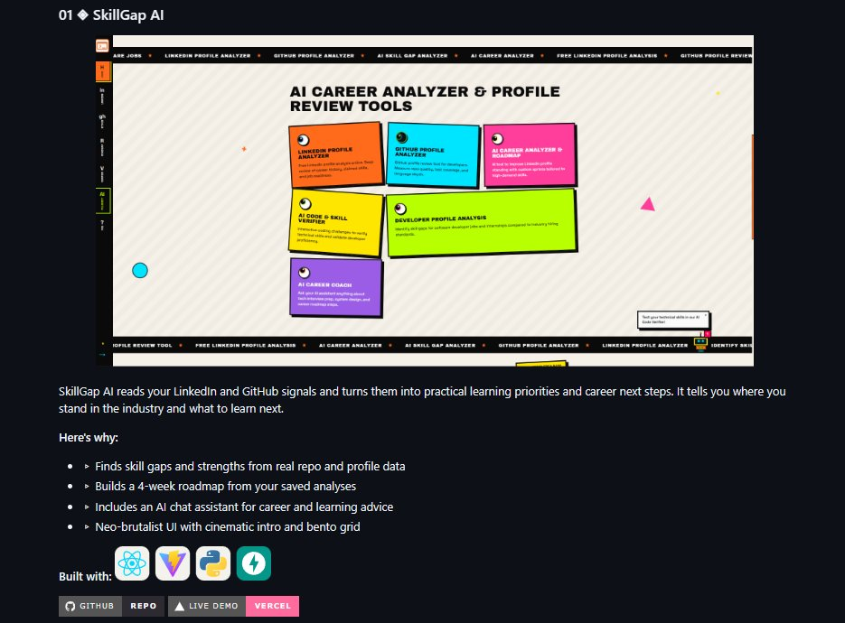

<div align="center">

# Skill Plus AI (SkillGap AI)
### *Next-Generation AI Career Gap Intelligence & Profile Review Suite*


[](https://react.dev/)
[](https://fastapi.tiangolo.com/)
[](./LICENSE)

<br />

<!-- Project Screenshot -->
<p align="center">
  
</p>

<!-- Centered Live Link Directly Below Screenshot -->
<p align="center">
  <b>Live Application:</b> <a href="https://skillplusai.vercel.app/" target="_blank"><b>https://skillplusai.vercel.app/</b></a>
</p>

<p align="center">
  <a href="https://skillplusai.vercel.app/" target="_blank">
    
  </a>
</p>

<br />

---

</div>

## Overview

**Skill Plus AI** (formerly SkillGap AI) is an intelligent, full-stack career platform designed for software engineers, tech students, and developers. It cross-examines your official **LinkedIn Profile PDF** against your public **GitHub code repositories** to identify critical competency gaps, benchmark engineering best practices, generate adaptive milestone sprint roadmaps, and provide a context-aware AI mentor (*PulseBot*).

> **100% Free Forever • Zero Sign-In Required • No Credit Card • In-Session Privacy First**

---

## Key Features

### 1. Free LinkedIn Profile & PDF Dossier Analyzer
- **Instant PDF Extraction**: Upload your official LinkedIn resume PDF exported directly via LinkedIn (**More -> Save to PDF**).
- **Competency Auditing**: Evaluates claimed experience, detected tech skills, and highlights missing industry qualifications.
- **ATS Readiness Scoring**: Real-time evaluation against current engineering hiring bars.

### 2. Deep GitHub Profile & Code Review Tool
- **Real-Time GitHub REST Integration**: Enter any public GitHub username (or profile link) with zero authentication barriers.
- **Byte-Weighted Language Signals**: Accurate repository code distribution, commit velocity, and consistency metrics.
- **Engineering Hygiene Checks**: Identifies missing test coverage, CI/CD automation pipelines, open-source engagement, and documentation depth.

### 3. Adaptive AI Career Roadmap & Sprint Planner
- **Synthesized Profile Intelligence**: Combines real signals from both your LinkedIn resume and GitHub audit.
- **Stack-Specific Calibration**: Adapts directly to your primary programming languages (Python, TypeScript, Go, Java, Rust).
- **Flexible Milestone Sprints**: Generates structured 3 to 7-week projects with concrete system architecture blueprints, test frameworks, and shippable deliverables.

### 4. Interactive AI Code & Skill Verifier
- **Hands-On Coding Assessments**: Timed, multi-language technical challenges calibrated to the languages detected in your GitHub profile.
- **Algorithmic Accuracy & Edge Cases**: Instant automated grading, syntax validation, and detailed question-by-question reviews.

### 5. PulseBot — Autonomous AI Career Coach
- **Roving Career Mascot**: Companion assistant powered by high-speed inference (Groq / Llama 3.3 70B).
- **Full Context Memory**: Primed with your verified profile strengths, gaps, and roadmap milestones to answer queries about tech interview prep, system design, and resume optimization.

---

## Tech Stack & Architecture

| Layer | Technologies |
| :--- | :--- |
| **Frontend** | React 18, Vite, Neo-Brutalist CSS System, Lucide Icons, Canvas Animations |
| **Backend** | Python 3.11, FastAPI, Starlette, Uvicorn, Pydantic v2 |
| **AI / LLM** | Groq API (`llama-3.3-70b-versatile`), Context-Driven Prompt Synthesis |
| **Parsing & APIs** | PyPDF (`pypdf`), GitHub REST API v3, Google Search Console & Schema.org JSON-LD |
| **Deployment** | Vercel Serverless Functions (`api/index.py`), SPA Static Serving |

---

## Repository Structure

```
Skill-Gap-AI/
├── assets/                      # Project screenshots & visual branding
│   └── project-screenshot.png
├── linkedin_analyzer/           # LinkedIn PDF Parser & Profile Review Module
│   ├── backend/                 # pypdf parsing service, schemas, and router
│   └── frontend/                # React UI component, /linkedin page, and api client
├── github_analyzer/             # GitHub Profiler & Code Quality Module
│   ├── backend/                 # GitHub REST API consumer & language analyzer
│   └── frontend/                # React UI component, autocomplete, /github page, and api client
├── roadmap/                     # Adaptive Career Roadmap Module
│   ├── backend/                 # Gap synthesis & sprint generator service
│   └── frontend/                # React UI component, /roadmap page, and api client
├── skill_verifier/              # Technical Assessment & Coding Sandbox
│   ├── backend/                 # Question bank, scoring engine, sandbox grader
│   └── frontend/                # React UI component, /verifier page, and api client
├── ai_agent/                    # Autonomous AI Career Coach Module
│   ├── backend/                 # PulseBot mentor engine (Groq/OpenAI compatible)
│   └── frontend/                # MascotCoach component, chat UI, and api client
├── backend/                     # Universal API App (FastAPI)
│   └── app/
│       ├── main.py              # Root router, SPA static server, sitemap handler
│       ├── config.py            # CORS & environment configuration
│       └── routers/             # Modular API endpoints (/api/*)
├── frontend/                    # Universal React SPA (Vite)
│   ├── src/                     # Components, pages, hooks, router, and context
│   ├── public/                  # Favicons, webmanifest, branding vectors
│   └── index.html               # Semantic HTML5, GEO/AEO Schema.org JSON-LD
├── run.bat                      # Windows one-click local developer runner
├── sitemap.xml                  # Root SEO sitemap with Google Image schemas
├── robots.txt                   # Search crawler indexing rules
└── vercel.json                  # Production Vercel deployment configuration
```

---

## Getting Started Locally

### Prerequisites
- **Node.js** (v18 or higher)
- **Python** (v3.10 or v3.11)
- **Git**

### 1. Clone the Repository
```bash
git clone https://github.com/Vidhitam-chakole/Skill-Gap-AI.git
cd Skill-Gap-AI
```

### 2. Backend Setup
```bash
cd backend
python -m venv venv

# Windows:
venv\Scripts\activate
# macOS / Linux:
# source venv/bin/activate

pip install -r requirements.txt
python -m uvicorn app.main:app --reload --port 8000
```
> Backend API will be available at: **http://localhost:8000**  
> Health Check endpoint: **http://localhost:8000/api/health**

### 3. Frontend Setup
In a new terminal window:
```bash
cd frontend
npm install
npm run dev
```
> Frontend will be running at: **http://localhost:5173**

---

### One-Click Startup (Windows)
You can launch both the backend and frontend simultaneously with a single command:
```cmd
run.bat
```

---

## Privacy & Guarantees

- **No Sign-In Required**: Start auditing LinkedIn dossiers or GitHub repos instantly without registering an account or entering an email.
- **Zero Data Retention**: Uploaded profile PDFs are processed entirely in memory/in-session and never stored permanently or sold to third-party recruiters.
- **100% Free**: No subscriptions, paywalls, or feature locks.

---

<div align="center">

**[Visit Skill Plus AI Live](https://skillplusai.vercel.app/)**

</div>
